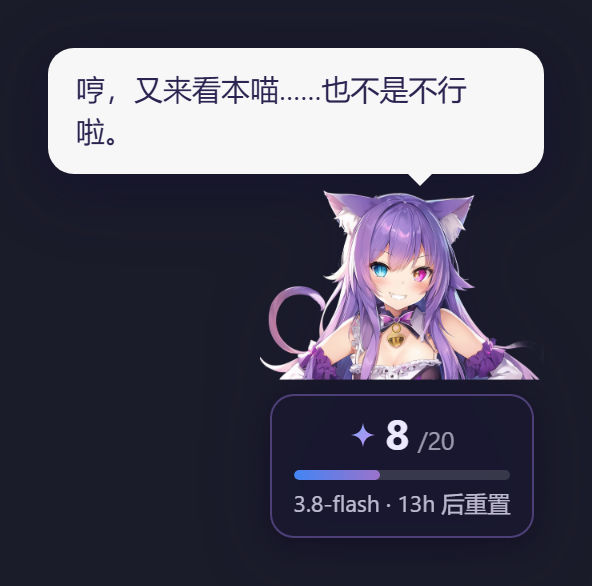
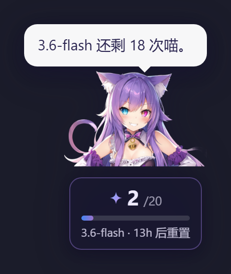

# dsh-gemini-kitten-widget 🐱

给 **DSH 界面**右下角常驻的一只 **Q 版 Gemini 猫娘**，实时显示 Google Gemini API 免费层的
**今日已用 / 剩余次数**。



*点猫娘本体换台词（上图）；点她肚子上的徽章轮换查看各个型号（下图，色级随之变化）。*



```
        ╭──────────────────╮
        │ 还有 12 次额度躺着 │     ← 点一下换台词
        │ 睡觉呢，真浪费喵。 │
        ╰────────┬─────────╯
            (\_/)                   💜 蓝紫长发
           ( ^ω^ )                  👂 猫耳
           /|   |\                  👁️ 异色瞳（左蓝 #4285F4 / 右紫）
        ┌────────────┐              😼 坏笑 + 小虎牙
        │ ✦ 8 /20    │
        │ ▓▓▓▓░░░░░░ │              ← 用掉 80% 变橙、95% 变红
        │3.8-flash   │              ← 副行显示当前型号
        │ 13h 后重置 │
        └────────────┘
```

## 为什么会有这个挂件

Gemini 的免费层**每个模型每天只有 20 次**，撞到上限就是 429 —— 而 429 意味着**这一轮子代理白跑**。
官方并不提供"我还剩几次"的查询接口，所以只能自己数。

如果你确实会在 DSH 里派 Gemini 子代理干活，这个小挂件能让你在**启动之前**就看见还剩多少。

## 配额口径（**这一节最重要**）

| 项 | 值 | 出处 |
|---|---|---|
| 限额 | **20 次 / 模型 / 天** | Google API 的 429 原文 |
| 重置 | **UTC 午夜**（= 北京次日 08:00） | 同上，由 `retry in` 反推 |
| 统计范围 | **只算 DSH 内**的调用 | 见下 |

**429 原文**长这样（两次独立实测得到）：

```
Quota exceeded for metric: generativelanguage.googleapis.com/generate_content_free_tier_requests,
limit: 20, model: gemini-3.8-flash
Please retry in 13h23m35s.
```

> ⚠️ **关于"250 次/天"的传闻**：网上流传的免费层限额（250 次/天、太平洋时间午夜重置）与
> API 实际返回的 `quotaId` 口径**对不上**。以 `GenerateRequestsPerDayPerProjectPerModel-FreeTier`
> 为准的话就是 **20 次/模型/天**。配额随时可能调整，所以分母和时区都做成了环境变量
> （`DSHK_QUOTA_PER_MODEL` / `DSHK_QUOTA_TZ`），**别把它焊死在代码里**。

### 三个必须知道的局限

1. **只统计 DSH 内发起的调用**。你在 Gemini CLI / AI Studio / 其他脚本里消耗的配额，
   本挂件**看不到** —— 所以挂件的数字**天然是个下界**（真实剩余可能更少）。
2. **配额是按模型分别算的**。挂件主显示盯着"**最紧的那个模型**"（用掉最多的），
   点徽章可以轮换查看各个型号。`gemini-3.8-flash` 用完不影响 `gemini-3.7-flash`。
3. **别名共享同一个池**。实测 `gemini-flash-latest` 是 `gemini-3.8-flash` 的别名，
   两者 429 的 `retry in` 完全一致 —— 换个马甲调用**照样吃同一份配额**。

## 数据从哪来

两道口子，**按权威度排序**：

1. **DSH 会话日志**（主）—— `~/.dsh/sessions/**/session.v4.jsonl.zstd`。
   日志是**多帧拼接的 zstd**（`zstdDecompressSync` 只解第一帧，直接读会只得一行），
   本插件逐帧解压、按 mtime/size 增量缓存（稳态开销 ~0ms）。
   计数取**两个口径的较大值**：
   - `step/start` 事件数（每个 step 至少一次模型调用）
   - `request/header` 事件数（真正发起请求的那一条）

   之所以取大值：只有 `assistant/message`（有响应）的调用会被漏掉——被中断的 turn、
   探活请求都不留响应记录，实测少算了近一半。
2. **可选的账本兜底** —— 如果本机装了鲸鱼娘挂件（`dsh-whale-widget`），会读它的
   `~/.dsh/.dshw-usage.json`。
   ⚠️ 它是**按 turn 聚合**的：一个 turn 里可能问模型几十次，它只写一条 ⇒ **账本条数 ≠ 调用次数**，
   仅当日志完全读不到时兜底。

## 交互

| 操作 | 效果 |
|---|---|
| **拖动** | 移动挂件；松手后自动**吸附**到最近的屏幕边缘 |
| **单击猫娘** | 换一句台词（台词随额度状态变化） |
| **单击徽章** | **切换查看哪个型号**（配额按模型独立，一行只放得下一个） |
| **右键** | 回到默认位置 |
| **悬停** | 全部型号的明细 / 重置时间 / 数据来源 |

位置记在 `localStorage`，刷新后保持。

## 安装

**方式一：直接从仓库装**（推荐）

```
# 在 DSH 会话里对 agent 说：
#   plugin_manager install_bundle  target = git+https://github.com/Void-LifeStream/dsh-gemini-kitten-widget
```

**方式二：先 clone，再用本地 link**

```powershell
git clone https://github.com/Void-LifeStream/dsh-gemini-kitten-widget
```

```
# 然后让 DSH 装本地目录（桌面端读 desktop profile，CLI 拒绝 --profile desktop）：
#   plugin_manager install_bundle  target = link:<clone 下来的绝对路径>
```

⚠️ **装完必须重启 DSH**：桌面端（Electron）的注入表是**宿主启动时一次性收集**的，
插件在运行期被加载时这一行进不了表 ⇒ 挂件不会出现。
**web 形态**（`dsh web`）走 `tapIndex`，同样建议重启一次。

⚠️ **依赖：无**。不需要任何 API key —— 本插件**只读本机数据**（DSH 会话日志 + 可选的余额账本），
**从不联网**、不写配置、不碰凭据。

⚠️ **没装鲸鱼娘挂件（`dsh-whale-widget`）也能用**：账本只是兜底数据源，没有它时会话日志照常工作。

### 装完先自测一下（可选）

```bash
node tools/selftest.mjs   # host 半离线自检：模块加载 / 注入行 / 路由 / 配额算法
```

它在**没有账本、没有会话日志**的干净环境里也应该跑通并打印 `自测结束`（退出码 0）。

## 自定义台词

内置台词写在 `assets/kitten.js` 的 `LINES` 里；想加自己的**不用改源码** ——
在 `~/.dsh/widget-lines.json` 建个文件：

```json
{
  "kitten": {
    "ok":     ["今天也要好好写代码喵。"],
    "warn":   ["省着点用喵。"],
    "danger": ["换一位吧，这位今天没劲了喵。"]
  }
}
```

host 半会随 `/dsh-kitten/state` 一起下发，客户端**追加**（不覆盖内置），
**改完刷新页面即生效、无需重启**。

占位符：`{used}` 已用次数 · `{remaining}` 剩余 · `{limit}` 每日上限 · `{model}` 当前型号短名。

## 技术形态

```
dsh-gemini-kitten-widget/
├─ package.json           dsh.bundle.patch → cordis.patch.yml
├─ cordis.patch.yml       挂载声明（insert 一条）
├─ lib/index.js           host 半：注入行 + 三个只读路由 + 配额统计
├─ assets/kitten.js       client 半：渲染 + 拖拽吸附 + 台词 + SVG 兜底
├─ assets/kitten-art.png  形象立绘（透明 PNG，本地生成）
└─ tools/                 自测与出图脚本（见下）
```

**两条注入通道**（桌面端与 web 形态各一条，各自去重）：

1. `webserver/index-inject` 推 **内联 `<script>` 行** —— 桌面端唯一通道。
   用内联行而不是 `script-src` 行：页面侧对 `script-src` 是「加载失败即 reject 整个 boot」，
   插件被关掉时路由注销 ⇒ 404 ⇒ **应用起不来**。内联行自己建 `<script src>` 并吞掉 `onerror`。
2. `webServer.tapIndex` 往 `index.html` 注入 `<script defer>` —— web 形态通道。

**路由**（都只读、不含任何凭据）：

| 路由 | 作用 |
|---|---|
| `GET /dsh-kitten/widget.js` | 客户端脚本，URL 带 **mtime 指纹**（改完刷新即生效，无需重启） |
| `GET /dsh-kitten/art.png` | 形象立绘，ETag 走 mtime |
| `GET /dsh-kitten/state` | 配额 JSON |

**跨会话台账（可选但推荐）**：host 半每 5 分钟把各模型剩余量写进
`~/.dsh/facts/gemini-quota-remaining.json`，这样**别的会话**（比如正要派子代理的那个）
不用打开界面就能知道还剩多少 —— 配合一个显示 `~/.dsh/facts/*.json` 的小脚本，
就能在开工时一眼看到。

**安全姿态**：本插件**不写配置、不碰凭据**，没有任何写入接口；
只做「`Sec-Fetch-Site: cross-site` 一律拒」+ 委托宿主的 `connection.requestRejection`。

### 开发

- **只改 `assets/kitten.js` 或 `kitten-art.png`** → 刷新页面即生效（mtime 指纹绕开缓存）。
- **改了 `lib/index.js`** → 需要重启 DSH。
- 改配额口径：`DSHK_QUOTA_PER_MODEL=20`、`DSHK_QUOTA_TZ=UTC`。
- 调试时可用的隔离环境变量：`DSHK_LEDGER`、`DSHK_SESSIONS_DIR`、`DSHK_PROBES`、`DSHK_LINES`。

### 自测脚本

需要 Node 18+：

```bash
node tools/selftest.mjs   # host 半离线自测：注入行 / 路由 / 配额算法
node tools/logtest.mjs    # 日志计数器：增量解帧 / 半截帧 / 截断重写（13 项）
node tools/uitest.mjs     # 浏览器回归：立绘 / 回退 / 拖拽吸附 / 台词 / 变色 / 切型号（26 项）
node tools/shot.mjs <输出目录>   # 出预览图（需要本机有 Chrome/Chromium）
```

`tools/uitest.mjs` 用的是**本地起的 HTTP 服务 + 无头 Chrome**，不碰你的真实数据。

### 血泪避坑（写给下一个改它的人）

1. **客户端脚本里绝不能 `require()` 内置符号**（`styles` / `host` 是 seed word）——
   后果是**整个 web boot 失败**、应用弹「无法启动」。要插样式就自建 `<style>` 并 `appendChild`。
2. **初始化路径上任何异常都会让挂件「活着但点不动」**（被空 catch 静默吞掉）——
   本插件所有早退分支都打 `console.error`，不静默。
3. **注入行必须最早注册**：桌面端的注入表一次性收集，晚一步就永远进不去。
4. **别用账本条数当"调用次数"**（按 turn 聚合，会严重低估）。
5. **多帧 zstd 要逐帧解**：`zstdDecompressSync` 只解第一帧，直接读会得到 1 行。
6. **浮层"居中于锚点"并不安全**：`left:50% + translateX(-50%)` 的定位在锚点贴近视口边缘时
   必然被推出屏幕，**与浮层多宽无关**。要按位置切换对齐方式（靠右改 `right:0`）。
   回归测试里加一条"浮层不超出视口"的断言能把它钉死。

## 形象来源

**本地 ComfyUI 生成 + `transparent-background` 抠图**，纯本地、零成本、不出网。

> 为什么不用网上现成的"猫娘二创"：画师作品**默认保留全部权利**，Gemini 娘的同人图
> 属"参考风格"而非可再分发素材；插件生态里的桌宠素材多绑定各自的皮肤/角色授权。
> **自己生成是唯一既干净又能贴合"蓝紫发 + 猫耳 + 异色瞳"设定的路。**

## 授权

MIT
